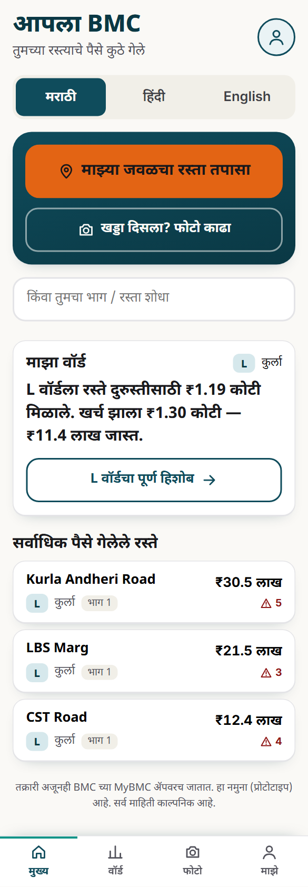
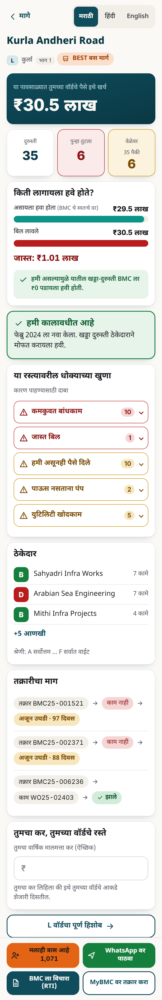
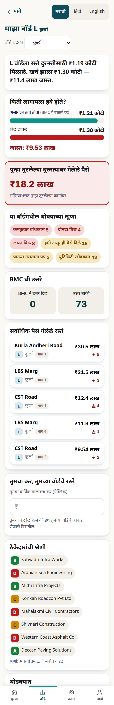
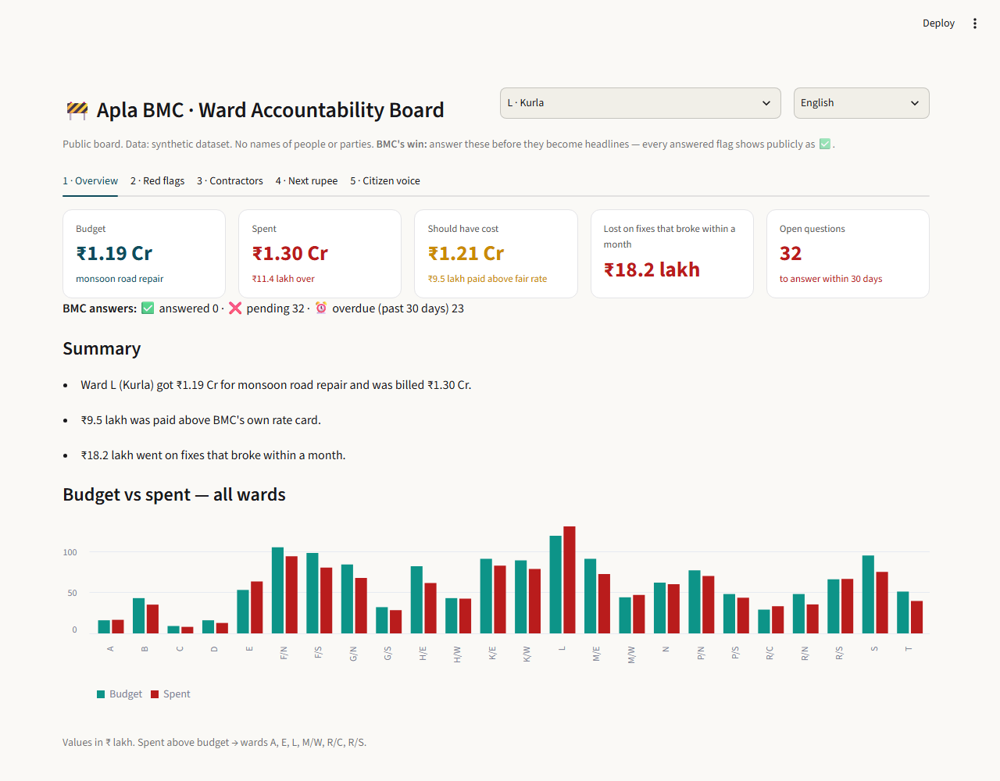

# आपला BMC · Apla BMC

### तुमच्या रस्त्याचे पैसे कुठे गेले · *Where your road's repair money went*

**Team 23 · Claude Impact Lab Mumbai · 21 Nov 2026**

| | |
|---|---|
| **Live phone app** | https://manasshete.github.io/claude-impact-build-/app/index.html |
| **Android APK** | https://manasshete.github.io/claude-impact-build-/AplaBMC.apk |
| **Code and data** | https://github.com/manasshete/claude-impact-build- |
| **Data** | *Follow the Rupee: Mumbai Monsoon Roads* (synthetic, CC BY 4.0). Every amount, date and contractor in this document is made up. |

---

## 1. The pitch in one breath

Every Mumbaikar knows the pothole outside their station. Nobody can find out **how much money went into that road, who did the work, whether it was billed fairly, whether the contractor still owed a free repair, and why it broke again.** BMC already has apps to *complain*. We built the missing half: an app that shows **the money, the contractor, the guarantee, and whether the fix lasted**, and gives a citizen three ways to push for an answer: **Me too**, **WhatsApp**, and a **ready-made RTI letter**. A second product, the **Ward Accountability Board**, gives journalists, citizens' groups and BMC's own ward office the proof, flag by flag, so the questions get answered before they become headlines.

**It is not a complaint app. It is not about blame. It is about the question nobody can currently answer.**

---

## 2. The problem

### Raju, 45, Kurla

Raju reads Marathi best. He uses WhatsApp daily and not much else. Every monsoon the same road near the station breaks, gets patched, and breaks again. He wants to know one thing: *"How much money went into this road, and why is it broken again?"*

Today he has nowhere to look.

- **Complaint apps** (MyBMC, the pothole app, the WhatsApp bot) take his complaint. They do not show him the spend, the contractor or the guarantee.
- **Budgets and tenders** exist, but they are not readable by an ordinary citizen, and not tied to *his* road.
- **RTI** is his legal right, but he does not know what to ask, which job IDs to cite, or how to word it.

### What goes wrong without visibility (in the dataset)

The dataset models a monsoon of **2,499 repair jobs**, **6,501 citizen complaints** in four languages and **291 road segments** across **24 wards**. In it:

- The city was billed **₹13.43 Cr** for work that BMC's own rate card prices at **₹12.40 Cr**, a gap of **₹1.03 Cr**.
- **24% of all repairs (611 of 2,499) failed within a month**, with ₹3.07 Cr spent on fixes that did not last.
- BMC paid for **274 pothole, paver and cave-in repairs on roads still under guarantee**, work the original contractor should have done free.
- Some roads were **resurfaced and then re-repaired again and again**: 45 roads, ₹81.6 lakh of surface repairs.
- **369 repair jobs followed utility trenches** (MTNL/MGL), ₹1.96 Cr that could be recovered from the companies that dug them.

None of this is visible to the person who walks that road.

---

## 3. Our answer: two products, one data brain

```
                    ┌─────────────────────────────────────────┐
  Dataset (CSV)  →  │  DATA BRAIN   build_data.py             │
  jobs, rate card,  │  fair cost · 10 checks · contractor     │
  roads, complaints │  grades · next-rupee ranking · RTI text │
  rain, tides, …    └───────────────┬─────────────────────────┘
                                    │  one file: apla_data.json
                  ┌─────────────────┴──────────────────┐
                  ▼                                    ▼
   CITIZEN APP  (phone, Marathi first)     WARD ACCOUNTABILITY BOARD (laptop)
   "What happened on my road?"             "What should this ward answer, and where
   Me too · WhatsApp · RTI                  should the next rupee go?"
```

| | Citizen app | Ward Accountability Board |
|---|---|---|
| **For** | Raju and anyone like him | Citizens' groups, journalists, corporators (any party), and the **BMC ward office** |
| **Question** | "Where did my road's money go?" | "Which bills need an answer, and who is doing fair work?" |
| **Form** | Phone web app and Android APK, no login, no backend | Streamlit dashboard reading one JSON file |
| **Language** | Marathi by default, Hindi and English one tap away | English, Marathi, Hindi text |

---

## 4. The citizen app

<table><tr>
<td></td>
<td></td>
<td></td>
</tr></table>

### Designed for Raju

- **Marathi first.** Hindi and English are one tap away.
- **No jargon, no percentages.** "6 times broke again", "₹30.5 लाख", "4 out of 10". Never "SLA", "DLP" or "audit".
- **Big text, big buttons** (buttons are at least 48 px tall) and **only four colours that mean something**: teal is the brand, ochre is pending, green is good or guaranteed, red is a problem, with tangerine reserved for what the citizen does.
- **Every number comes from the data.** The app never calculates or invents.

### The road card: "रस्त्याचा हिशोब"

For **Kurla Andheri Road** (the demo road), the app shows at a glance:

| What Raju sees | Value |
|---|---|
| Money spent this monsoon | **₹30.5 लाख** |
| Repairs | **35** |
| Broke again | **6** |
| Finished on time | **6 of 35** |
| What it *should* have cost (BMC's own rate card) | **₹29.5 लाख** |
| What was billed | **₹30.5 लाख**, about ₹1 लाख extra |
| Guarantee | **Resurfaced Feb 2024. Under guarantee, so pothole repairs should have cost BMC ₹0.** |
| Red flags, each tappable for a plain reason | Built weak (10 repairs since resurfacing), Overcharged, Paid despite guarantee, Pump with no rain, Dug by a utility company |
| Contractors, graded A to F | Name, grade, number of jobs |
| Complaint trail | Complaint → job → Done, or "still open · 97 days" |

### Three ways to act

1. **Me too.** One tap per road per device, with the count shown. It builds the public signal.
2. **WhatsApp.** A ready message in the chosen language (the road, the spend, "broke again N times", and "under guarantee, repairs should have been free") with a link that opens the live app.
3. **Ask BMC (RTI).** A pre-written letter under the RTI Act 2005 that asks for the bills and measurement records **for the exact job IDs on that road**, and for the guarantee clause when the road is under guarantee. He adds his name and address (kept only on his phone, never stored), then copies it or sends it by WhatsApp.

### A photo needs a place

Raju can add a photo of a pothole, but the app **never pretends to read it**. A photo alone gets **no answer**. It asks where it is, and accepts any of:

- the photo's own location, when the file has one;
- the phone's current location;
- a **Google Maps link** or plain coordinates;
- a typed address, road or area name (shown as a short list to pick from).

A place outside Mumbai is refused, a short `goo.gl` link asks for the full address, and the sample road is never used to answer a photo. This closes a real hole: without it, *any* picture would have produced an answer.

### Profile, updates and the tax card

- **Me tab:** optional name, home ward, language, the photos he added (each with how it was located), the roads he backed, and **latest on your roads**: how many complaints are still open and for how long.
- **Tax card:** he types his yearly property tax and sees it **beside** what his ward spent on roads this monsoon, how much of that was above BMC's own rate, and how much went on fixes that broke within a month. It is a side-by-side comparison. **It does not divide, estimate or claim how his money was used.** We chose honesty over a number that looks impressive.
- **Privacy:** everything stays on the phone. Nothing is uploaded. Two taps erase it all.

---

## 5. The Ward Accountability Board



Built for people who need **proof, not anger**. Pick any of the 24 wards:

| Tab | What it gives |
|---|---|
| **Overview** | Budget, spent (with a meter against budget), what it should have cost, money lost on fixes that broke within a month, open questions; BMC's answered, pending and overdue; a three-line summary; a chart of budget against spend for all wards, with the chosen ward highlighted |
| **Red flags** | Every flagged job with road, contractor, amount, fair cost, a **30-day clock** and a status. Click a row for the evidence: dates, rate-card line, linked complaints. **BMC can respond in public**: Answer, Hold payment, Ask the contractor to fix free, Recover from the utility company |
| **Contractors** | A report card per contractor: grade A to F, fixes that lasted, jobs on time, price against the rate card, red-flag count. Compared **only within the same ward**, so a flood-prone ward is not unfairly judged |
| **Next rupee** | The five roads where the next repair rupee should go, ranked by risk (repeat failures, accidents, schools and ambulance routes, congestion, bus routes, citizen "Me too"), with a suggested fix and cost. **Guarantee roads come with "make the original contractor repair it, cost to BMC ₹0"** |
| **Citizen voice** | A complaints → duplicates → issues → never-fixed funnel, a summary of what citizens say (complaints arrive in English, Hindi, Marathi and Hinglish), and the roads with the most "Me too" |

**BMC's win, said in the product:** *answer these before they become headlines. Every answered flag shows publicly as answered.* The board is built so the ward office can get **credit for answering**, not just criticism.

---

## 6. The data brain: how it finds what is worth asking

Everything is computed once by `build_data.py` and written to **one file, `apla_data.json`**, so the demo never waits on a calculation.

### The fair price

Every job is matched to BMC's own **rate card** (per square metre or per job). `ratio = billed ÷ fair`. Normal jobs sit between 0.75 and 1.3, so **normal variation is never flagged.**

| Level | Should have cost | Billed | Gap |
|---|---|---|---|
| City | ₹12.40 Cr | ₹13.43 Cr | ₹1.03 Cr |
| L ward (Kurla) | ₹1.21 Cr | ₹1.30 Cr | ₹9.5 lakh |
| Kurla Andheri Road | ₹29.5 lakh | ₹30.5 lakh | ₹1.0 lakh |

### Ten checks, with the size of each in the data

*Precision matters more than quantity.* The checks overlap (one job can trip several), so the figures below are **not** added together.

| # | Check | Rule | Size in the data |
|---|---|---|---|
| 🔴 1 | **Overcharged** | billed above 1.5× the rate card | **109 jobs**, ₹60.1 lakh above fair |
| 🔴 2 | **Billed twice** | same road and method within 7 days, with no complaint behind it | **45 jobs**, ₹25.9 lakh |
| 🔴 3 | **Work nobody asked for** | no citizen complaint linked | 45 jobs (the same set) |
| 🔴 4 | **Guarantee road paid by BMC** | pothole, paver or cave-in repair on a road under guarantee | **274 jobs**, ₹87.3 lakh |
| 🔴 5 | **Built weak** | under guarantee, yet 3+ surface repairs or 2+ that broke again | **45 roads**, ₹81.6 lakh |
| 🟠 6 | Fix failed within 30 days | reopened within 30 days, with a heavy-rain note | 611 jobs (24%), ₹3.07 Cr |
| 🟠 7 | Repeat patching | patched 3+ times this monsoon | 193 roads, ₹1.93 Cr |
| 🟠 8 | Pump with no rain | pump job with under 5 mm of rain in the 3 days before, and no big tide | 9 jobs |
| 🟠 9 | Utility damage | repair after an MTNL/MGL trench | 369 jobs, **₹1.96 Cr to recover** |
| 🟠 10 | Complaint closed by an older repair | marked fixed using a job done before it was filed | 364 complaints |

Red flags are *"bills to check"*. Amber flags are *"check with context"* and are **not counted as corruption**.

### Built to be fair

- **We checked, and did not flag, what is honest.** Deadline data is consistent; areas never exceed the road; contractors working outside their listed wards is normal and is ignored.
- **Rain and floods are not the road contractor's fault.** Waterlogging, drain and manhole jobs are never counted against a road's guarantee or build quality.
- **Contractors are compared within the same ward** only, with a note when the ward is flood-prone.
- **Wording is careful.** We say "bills to check", never "corrupt". Every flag shows its job ID and its proof.
- **No politics.** The system never shows a party, corporator or officer name. Accountability sits at **contractor** and **ward office** level. Where a citizen's complaint text names a party office as a landmark, the board replaces it with "[name removed]" (50 places in the data).

---

## 7. Three-minute demo

| Time | Show | Say |
|---|---|---|
| 0:00 | Open the live app on a phone. Marathi home screen. | "Raju sees this pothole every monsoon. He has nowhere to find out where the money went." |
| 0:20 | Tap **माझ्या जवळचा रस्ता तपासा**. (Away from Mumbai it opens the sample road, with a note saying so.) | "One tap. This is Kurla Andheri Road." |
| 0:35 | Road card: ₹30.5 लाख, 35 repairs, **6 broke again**. | "35 repairs. It broke again six times." |
| 0:55 | Bars: should have cost ₹29.5 लाख, billed ₹30.5 लाख. Green guarantee box. | "BMC's own rate card says ₹29.5 लाख. And it was resurfaced in February 2024, so it is **still under guarantee**. These repairs should have cost BMC nothing." |
| 1:15 | Open the flags: Built weak, Paid despite guarantee. | "Ten pothole repairs since it was resurfaced. Each flag explains itself in plain Marathi." |
| 1:35 | Tap **Me too**, then **Ask BMC (RTI)**, type a name, **Copy**. | "He is not angry, he is *informed*. A ready RTI asking for the exact job IDs." |
| 1:55 | Switch to **हिंदी** then **English**. | "Same facts, three languages." |
| 2:05 | Take a photo, show it **asks where it is**, paste a Google Maps link. | "A photo alone gets no answer. We ask where it is, so nobody can fake a result." |
| 2:25 | Open the **Board**, L ward, **Red flags** tab. Click a row. | "The ward office sees the same facts. Every flag has proof and a 30-day clock. They can answer, hold payment, or ask the contractor to fix it free." |
| 2:50 | **Next rupee** tab. | "And this is where the next rupee should go. Number one: Kurla Andheri Road, with a ₹0 fix: make the original contractor repair it under guarantee." |

---

## 8. Why this is different

| | Complaint apps (MyBMC, pothole app, WhatsApp bot) | **Apla BMC** |
|---|---|---|
| Takes a complaint | Yes | We link to them rather than replace them |
| Shows money spent on *this* road | No | **Yes** |
| Shows what it *should* have cost | No | **Yes, from BMC's own rate card** |
| Shows contractor and their record | No | **Yes, graded fairly** |
| Knows the guarantee and the free-repair right | No | **Yes** |
| Shows whether the fix lasted | No | **Yes** |
| Turns a citizen into an informed requester | No | **Yes: ready RTI with real job IDs** |
| Gives the ward office a way to answer in public | No | **Yes** |

**Our wedge:** BMC does not act on random complaints. It acts when there is **public pressure with proof**. We make the proof easy to get and easy to share.

---

## 9. How we built it, and what Claude did

We built it from two written specs, one for each product, using **Claude Code** as the build partner.

- **Claude Code** wrote the data brain, the dashboard and the app changes, ran the checks against the dataset's reference numbers, and **audited its own work**: a full audit of the phone app (165 checks across every road, ward and language) found and fixed real bugs, including a broken-link crash that blanked the app.
- **The Claude API is optional and honest.** `python build_data.py --claude` has Claude write ward summaries, RTI applications, contractor notes and the citizen-voice summary in English, Marathi and Hindi, with the rule *"be fair, state facts with job IDs, do not accuse anyone, do not name any person or party."* The text is generated **once and cached in the JSON**, so the live demo never waits on an API call. Without a key, the same texts come from fixed templates built from the real numbers.
- **We never let a model touch the numbers.** Every figure comes from code over the dataset. Language is the only thing that is ever generated.

> *To be straightforward with judges:* the default build uses templates for Marathi and Hindi text, and the Claude-written version is switched on with `--claude`. The Marathi and Hindi wording should be read by a native speaker before any real-world use.

---

## 10. Under the hood

| Layer | Choice | Why |
|---|---|---|
| Phone app | Plain HTML, CSS and JavaScript, no build step | Opens from a file or any static host; works on a cheap phone |
| Android | A small Java WebView wrapper (`AplaBMC.apk`) | Installs with a tap; offers camera and gallery for photos |
| Hosting | GitHub Pages for the phone app | Free, HTTPS, so location works |
| Data brain | Python, pandas, one script → one JSON | Reproducible; the app only reads |
| Board | Streamlit with Altair | Laptop-friendly, fast to build, easy to deploy |
| Photos | Location from EXIF, GPS, Google Maps link or address | A photo is only proof; the place is what identifies the road |
| Storage | Browser local storage only | No account, no server, nothing uploaded |
| Languages | A single `translations` object (mr, hi, en) | Marathi by default |

### Quality

- **Data brain:** reference numbers checked on every run (city and ward totals, 109 overcharged, 45 billed twice, WO25-02459 paired with WO25-02052, 45 built-weak roads with RD0176 on top, 369 utility jobs, 364 complaints closed by an older repair, the six overspent wards, and the next-rupee top three for L ward).
- **Phone app:** a logic suite against the spec's cases, a browser suite, a photo, profile and tax suite, and a **165-check full audit**: every road, ward and RTI letter in all three languages (no `undefined`, no jargon, no `%`, no party names), every interaction, five screen widths from 320 to 768 px, accessibility (labels, focus, contrast of 19 colour pairs), offline use, speed, and the APK itself.
- **Accessibility:** touch targets of at least 44 px (buttons 48 px), keyboard focus, labelled fields, and text colours that meet 4.5:1.

---

## 11. Honest limits

We would rather say these than have a judge find them.

- **The data is synthetic.** No real contractor, officer or amount appears. The flags show the method, not findings about real people.
- **Two data builders.** The phone app and the board each read their own JSON, and their rules differ in places (built-weak flags 32 roads in the app and 45 on the board). The same road can show slightly different flag counts. Merging them is the first next step.
- **"Not a BMC road"** is built but never triggers in the phone app, because the dataset has no road-owner column.
- **The APK is debug-signed** (fine for sideloading, not the Play Store) and **has not been run on a physical Android device**. We tested the web app thoroughly in a real browser and the APK's contents statically.
- **Hindi and Marathi text** needs a native reader.
- **We do not price building a new road.** The data has no material, wage or machine rates.

---

## 12. Where this goes next

1. **One data brain for both products**, so the app and the board always agree.
2. **Real data.** Use RTI replies and BMC's published tenders to replace the synthetic set, with the same method.
3. **Close the loop.** Let ward offices publish answers that show up on the citizen's road card ("BMC replied on 12 Nov").
4. **Reach.** A WhatsApp-first flow for people who never install anything, and a Play Store release.
5. **Ideal cost of a new road** from material, wage and machine rates, once the data exists.
6. **Pilot with one ward.** A ward office or a citizens' group in a single ward, with real jobs, real questions and a 30-day answer clock.

---

## 13. The ask

We are not asking anyone to trust a black box. We are asking for:

- **A ward to pilot with:** a ward office or a civic group willing to answer flags in public for 30 days.
- **Real data access:** RTI-sourced or open job, rate card and complaint data for that ward.
- **Native-language review:** Marathi and Hindi readers to check the wording before anything goes public.

---

## 14. Likely questions

**Isn't this just accusing contractors?**
No. Red flags are "bills to check", each with a job ID and proof. Normal price variation is never flagged, floods are never blamed on a road contractor, and contractors are compared only within the same ward.

**How do you avoid false flags?**
Precision over quantity. Rules are narrow and documented, the 1.5× overcharge line sits well above normal variation (a job at 1.25× is never flagged), and we list what we checked and found honest.

**What about privacy?**
No account and no server. A name, tax figure, photo and RTI details stay on the phone and can be erased in two taps. The RTI name and address are never stored.

**Can someone fake a report with a random photo?**
No. A photo alone gets no answer. It needs a place, and a place outside Mumbai is refused.

**Why not just fix the complaint apps?**
Complaints say *something is broken*. Citizens and journalists need to know *who was paid, how much, and whether it lasted*. That is a different dataset and a different audience, and we link to the complaint apps rather than replace them.

**Does it depend on an AI model at runtime?**
No. Numbers come from code. Claude can write the text once, offline, and the result is cached in the data file.

**Will BMC resist it?**
The board is designed to give the ward office **credit for answering**: every answered flag shows publicly as answered, and the guarantee findings point to money BMC can recover (a free repair from the original contractor, and restoration costs from utility companies).

---

## 15. Dataset credit

Uses **Follow the Rupee: Mumbai Monsoon Roads** by Sumeet Doshi for Claude Impact Lab Mumbai, <https://github.com/SumeetGDoshi/Claude-Impact-Labs-data-2>, licensed [CC BY 4.0](https://creativecommons.org/licenses/by/4.0/). **All data is synthetic and all contractors are fictional.** Ward codes, locality and road names are real names used only for realism. Do not use it to judge any real person, contractor or department.
