# आपला BMC · Apla BMC

### तुमच्या रस्त्याचे पैसे कुठे गेले · *Where your road's repair money went*

A phone app and a ward dashboard that show Mumbaikars **how much money went into a road, who did the work, what it should have cost, whether the contractor still owed a free repair, and whether the fix lasted.** Complaint apps already exist. This is the missing half.

> Team 23 · Claude Impact Lab Mumbai · 21 Nov 2026
> **All data is synthetic and all contractors are fictional.** Nothing here is a finding about any real person, contractor or department.

<table><tr>
<td>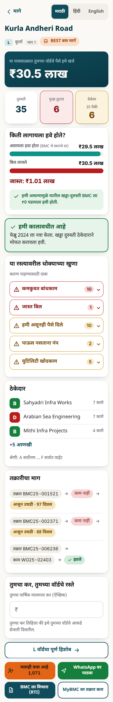</td>
<td>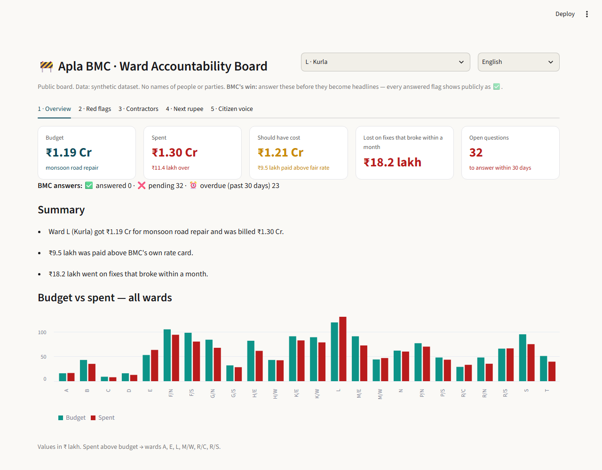</td>
</tr></table>

## Try it

| | |
|---|---|
| **Phone app (web)** | https://manasshete.github.io/claude-impact-build-/app/index.html |
| **Android app (APK)** | https://manasshete.github.io/claude-impact-build-/AplaBMC.apk (allow "Install unknown apps") |
| **Ward dashboard** | Run locally (see [Quick start](#quick-start)) or deploy free on Streamlit Community Cloud (see [Deploy](#deploy)) |
| **The full pitch** | [PITCH.md](PITCH.md) |
| **Use case story** | [USE_CASE.md](USE_CASE.md): one citizen's photo becomes a held payment and a free repair |

## Contents

**For everyone**
[What it does](#what-it-does) · [The problem](#the-problem) · [Screenshots](#screenshots) · [How it decides what to flag](#how-it-decides-what-to-flag) · [Built to be fair](#built-to-be-fair)

**For developers**
[Quick start](#quick-start) · [The live loop](#the-live-loop) · [Repo layout](#repo-layout) · [Architecture](#architecture) · [Data files](#data-files) · [The phone app](#the-phone-app-dev-notes) · [The data brain](#the-data-brain-dev-notes) · [Tests](#tests) · [Build the APK](#build-the-apk) · [Deploy](#deploy) · [Configuration](#configuration) · [Known limits](#known-limits) · [Roadmap](#roadmap) · [Credits](#credits)

---

# For everyone

## What it does

Two products read one data file.

| | **Citizen app** | **Ward Accountability Board** |
|---|---|---|
| **For** | Raju, 45, Kurla, who reads Marathi and lives on WhatsApp | Citizens' groups, journalists, corporators (any party) and **BMC's ward office** |
| **Answers** | "Where did my road's money go?" | "Which bills need an answer, and where should the next rupee go?" |
| **Form** | Phone web app and Android APK. No login. Works on its own, or connected to a ward board | Streamlit dashboard (laptop) |
| **Language** | Marathi by default, Hindi and English one tap away | English, Marathi and Hindi text |

**It is not a complaint app.** Complaints still go to BMC's own MyBMC. We add what none of them show: **the money, the contractor, the guarantee, and whether the fix lasted.** No party, corporator or officer name appears anywhere.

### The citizen app

- **Road card.** For any road: money spent this monsoon, repairs, how many broke again, what it *should* have cost (BMC's own rate card) against what was billed, and whether it is still **under guarantee** (then pothole repairs should have cost BMC ₹0). Red flags explain themselves in plain words. Contractors are graded A to F. A complaint trail shows complaint → job → done, or "still open".
- **Three ways to act.** **Me too** (one tap per road per device). **WhatsApp** (a ready message in the chosen language with a link to the live app). **Ask BMC (RTI)** (a ready letter under the RTI Act 2005 that cites the *exact job IDs* on that road).
- **A photo needs a place.** The app never reads the photo. A photo alone gets **no answer**; it asks where it is: the photo's own location, the phone's GPS, a **Google Maps link**, or a typed address. A place outside Mumbai is refused, and the sample road is never used to answer a photo.
- **Me tab.** Optional name, home ward, language, the photos you added, the roads you backed, and *latest on your roads* (complaints still open, and for how long). Erase everything in two taps.
- **Tax card.** Type your yearly property tax and see it **beside** what your ward spent on roads this monsoon, how much was above BMC's own rate, and how much went on fixes that broke within a month. A side-by-side comparison only: it does not divide or estimate how your money was used.
- **Raise a complaint** *(when the app is connected to a ward board)*. A note, an optional photo and an optional place go straight to the ward board. The screen says exactly what is sent, a small photo copy goes **only if you allow it**, and your name is never sent. Without a connection the complaint is saved and sent when you are back online.
- **The ward office's answer, on your road.** When the ward office answers, holds a payment or asks the contractor to fix the road free, the citizen sees it on the road card and in the Me tab, in their language.
- **Privacy.** On its own, everything stays on the phone and nothing is uploaded. Only when the app is connected to a ward board does a complaint you choose to send leave the phone: the road, your note, the place (rounded to about 11 m) and, if you allow it, a small photo. No names and no IP addresses are stored. A device is a random id, and the board only ever sees a one-way hash of it.

### The Ward Accountability Board

| Tab | What it gives |
|---|---|
| **Overview** | Budget, spent (with a meter against budget), what it should have cost, money lost on fixes that broke within a month, open questions, BMC's answered / pending / overdue, a **live strip of complaints from the phone app**, a three-line summary, and a budget-against-spend chart for all wards |
| **Red flags** | Every flagged job with a 30-day clock, status and a **Voice** column. Click a row (or open `?flag=WO25-02068`) for the proof **and the citizens' voice on that road**. **BMC can answer in public**: Answer, Hold payment, Ask contractor to fix free, Recover from utility, Release. Each is saved and shows on the citizen's road |
| **Contractors** | A report card per contractor: grade, fixes that lasted, jobs on time, price against rate card. Compared **only within the same ward** |
| **Next rupee** | The five roads where the next repair rupee should go, with a suggested fix and cost. Guarantee roads come with "make the original contractor repair it, cost to BMC ₹0" |
| **Citizen voice** | **Live complaints from the phone app**, roads ranked by voice, and a **critical-voice check** (independent devices, an unanswered red flag, a failed fix and a contractor with a D-or-worse record must all agree; voice alone never counts). Below that, the dataset's complaints → duplicates → issues → never-fixed funnel and the roads with the most "Me too" |

> **BMC's win, said in the product:** *answer these before they become headlines. Every answered flag shows publicly as answered.*

## The problem

Every Mumbaikar knows the pothole outside their station. Nobody can find out how much money went into it. Complaint apps take the complaint but do not show the spend, the contractor or the guarantee; tenders are not readable by an ordinary citizen; and RTI is a right most people do not know how to use.

In the dataset (2,499 repair jobs, 6,501 complaints, 291 road segments, 24 wards):

| Finding | Size |
|---|---|
| Billed against BMC's own rate card, city-wide | **₹13.43 Cr** billed for **₹12.40 Cr** of work: a gap of **₹1.03 Cr** |
| Repairs that failed within a month | **611 of 2,499 (24%)**, ₹3.07 Cr |
| Pothole, paver and cave-in repairs paid by BMC on roads still under guarantee | **274 jobs**, ₹87.3 lakh |
| Roads resurfaced and then re-repaired repeatedly ("built weak") | **45 roads**, ₹81.6 lakh of surface repairs |
| Repairs after utility-company trenches (money that could be recovered) | **369 jobs**, ₹1.96 Cr |

These overlap and are not meant to be added together. The detail and a 3-minute demo script are in [PITCH.md](PITCH.md).

## Screenshots

**Phone app**

| Home | Road card | My ward | Photo needs a place | Me tab |
|---|---|---|---|---|
| 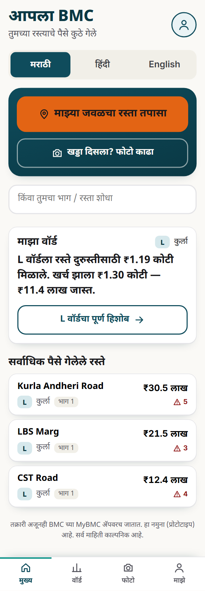 |  | 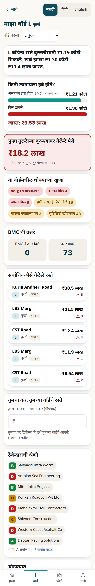 | 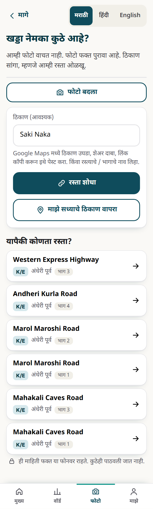 | 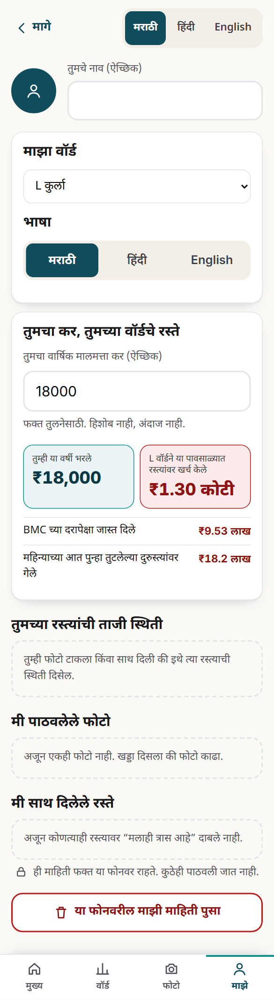 |

**Board**

| Overview | Red flags | Contractors |
|---|---|---|
|  | 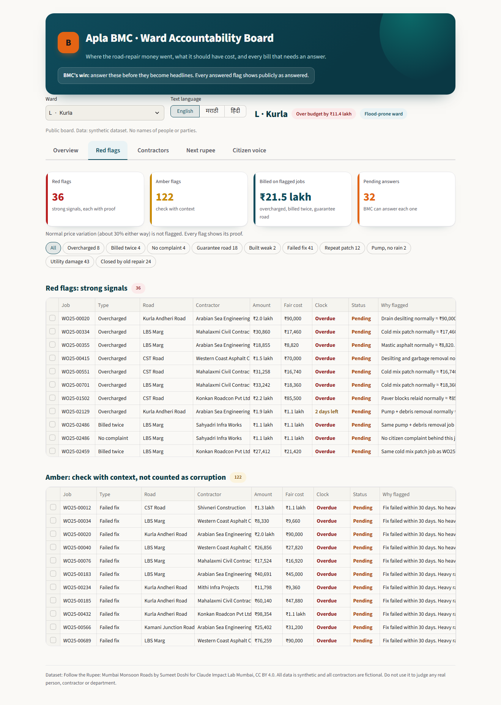 | 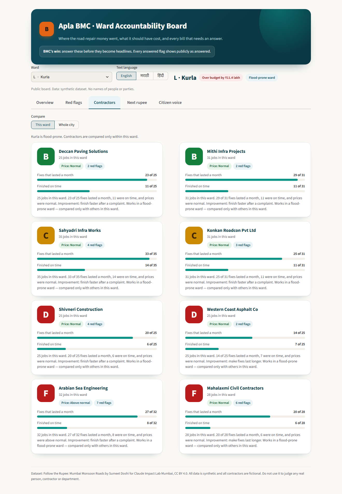 |

**The live loop** (a complaint on the phone, the ward office's decision on the board, the answer back on the road)

| Raise a complaint | The ward office's answer, on the road | Live complaints and critical voice | Voice next to the proof, and the actions |
|---|---|---|---|
| 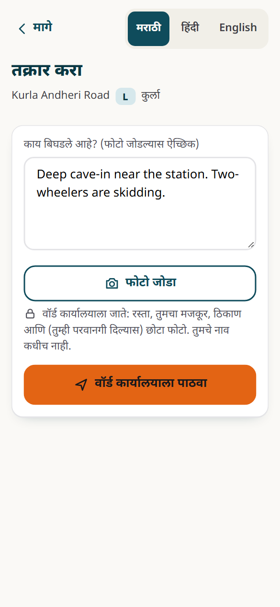 | 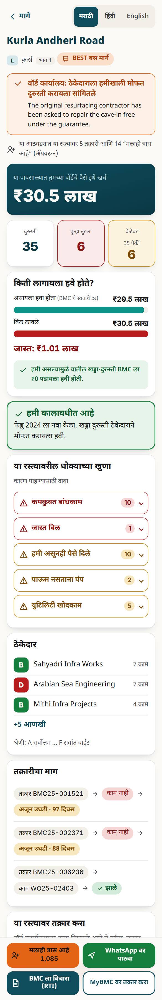 | 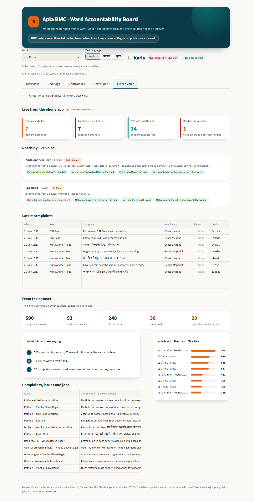 | 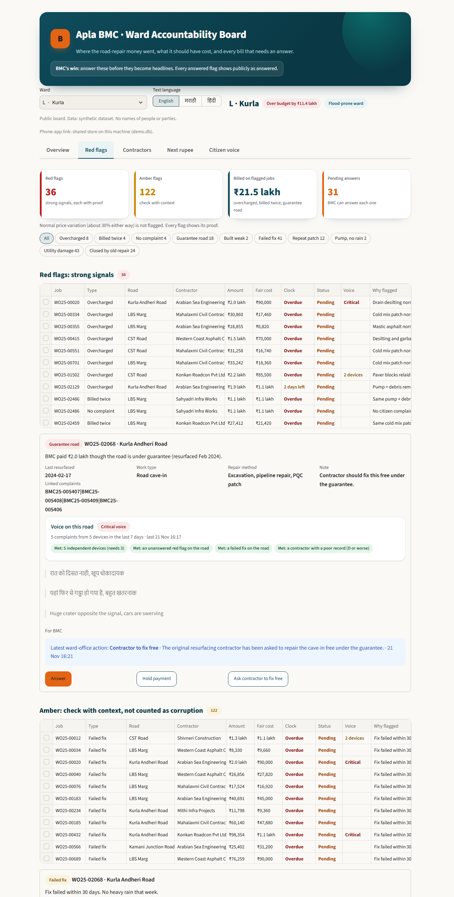 |

## How it decides what to flag

Every job is matched to BMC's **rate card** (per square metre or per job). `ratio = billed ÷ fair`. Normal jobs sit between 0.75× and 1.3×, so **normal variation is never flagged.**

| Level | Should have cost | Billed | Gap |
|---|---|---|---|
| City | ₹12.40 Cr | ₹13.43 Cr | ₹1.03 Cr |
| L ward (Kurla) | ₹1.21 Cr | ₹1.30 Cr | ₹9.5 lakh |
| Kurla Andheri Road | ₹29.5 lakh | ₹30.5 lakh | ₹1.0 lakh |

**Red flags are "bills to check"** (counted):

| Check | Rule | Size in the data |
|---|---|---|
| **Overcharged** | billed above 1.5× the rate card | 109 jobs, ₹60.1 lakh above fair |
| **Billed twice** | same road and method within 7 days, no complaint behind it | 45 jobs, ₹25.9 lakh |
| **Work nobody asked for** | no complaint linked to the job | 45 jobs (same set) |
| **Guarantee road paid by BMC** | pothole, paver or cave-in repair on a road under guarantee | 274 jobs, ₹87.3 lakh |
| **Built weak** | under guarantee, yet 3+ surface repairs or 2+ that broke again | 45 roads, ₹81.6 lakh |

**Amber flags are "check with context"** (shown separately, not counted as corruption):

| Check | Rule | Size in the data |
|---|---|---|
| Fix failed within 30 days | reopened within 30 days, with a heavy-rain note | 611 jobs |
| Repeat patching | patched 3+ times this monsoon | 193 roads |
| Pump with no rain | pump job with under 5 mm of rain in the 3 days before, and no big tide | 9 jobs |
| Utility damage | repair after an MTNL/MGL trench | 369 jobs, ₹1.96 Cr to recover |
| Complaint closed by an older repair | marked fixed using a job done before it was filed | 364 complaints |

## Built to be fair

- **What is honest is not flagged.** Deadline data is consistent, areas never exceed the road, and contractors working outside their listed wards is normal.
- **Floods are not the road contractor's fault.** Waterlogging, drain and manhole jobs are never counted against a road's guarantee or build quality.
- **Contractors are compared within the same ward**, with a note when the ward is flood-prone.
- **Careful wording.** "Bills to check", never "corrupt". Every flag shows its job ID and proof.
- **No politics.** No party, corporator or officer name is ever shown. Where a complaint's text names a party office as a landmark, `build_data.py` replaces it with "[name removed]".

---

# For developers

## Quick start

You need Python 3.10+ for the board and the data brain, and Node 22+ plus Chrome or Edge for the phone-app tests. The phone app itself needs nothing.

**Run the board**

```bash
pip install -r requirements.txt
python build_data.py            # writes apla_data.json and prints the data checks
streamlit run app.py
```

**Run the phone app**

```bash
# quickest: double-click app/index.html (works from disk; location is off, so it shows the sample road)
# with location (needs localhost or HTTPS):
cd app && python -m http.server 8000      # then open http://localhost:8000 in a phone-size view (390 px)
```

**Run the whole loop** (phone → board → phone, details in [The live loop](#the-live-loop)):

```bash
python server/api.py                    # the signal API on http://127.0.0.1:8787
streamlit run app.py                    # the board reads the same database
cd app && python -m http.server 8000    # then open http://127.0.0.1:8000/?api=http://127.0.0.1:8787
```

**Rebuild the phone app's data** (standard library only):

```bash
python -I scripts/build_apla_data.py dataset/data app/
```

## Repo layout

```
.
├── app/                     Phone web app. Plain HTML + CSS + JS, no build step
│   ├── index.html
│   ├── app.js               routing, screens, photo→place, profile, tax card
│   ├── i18n.js              every UI string: translations = { mr, hi, en }
│   ├── styles.css           Emerald Ledger palette as tokens at :root
│   └── apla_data.json/.js   data the phone app reads (.js lets it open from disk)
├── android/                 Java WebView wrapper (no libraries); builds AplaBMC.apk
├── AplaBMC.apk              Debug-signed build of app/ for sideloading
├── build_data.py            The data brain for the board: fair cost, 10 checks, grades, ranking
├── apla_data.json           Its output (the board reads only this)
├── app.py                   The Ward Accountability Board (Streamlit)
├── scripts/
│   └── build_apla_data.py   Builds app/apla_data.json for the phone app
├── server/                  The link between phone and board
│   ├── api.py               Signal API (standard library): complaints, Me too, ward-office actions
│   ├── store.py             SQLite store: reports, metoo, actions
│   └── test_api.py, test_board.py
├── dataset/                 The synthetic dataset (CSVs) and its data dictionary
├── tests/                   check, e2e, e2e-report, e2e-live and audit (Node)
├── docs/                    Screenshots
├── index.html               Redirects the GitHub Pages root to app/
├── PITCH.md                 The full pitch
└── requirements.txt         pandas, streamlit, altair, anthropic
```

## Architecture

```
                      ┌────────────────────────────────────────────────┐
 dataset/data/*.csv → │ build_data.py      fair cost, 10 checks,       │ → apla_data.json ─┐
 jobs, rate card,     │                    contractor grades, ranking, │                   │
 roads, complaints,   │                    RTI text, citizen trail     │                   ▼
 rain, tides …        └────────────────────────────────────────────────┘        app.py (Streamlit board)

 dataset/data/*.csv → scripts/build_apla_data.py → app/apla_data.json → app/ (phone web app) → android/ (APK)
```

Both apps are **read-only views** of the dataset: they never recompute a number. Claude is never needed at runtime (see [Configuration](#configuration)).

On top of that, an optional **live loop** carries what citizens do and what the ward office decides:

```
 phone app ──complaints, Me too──▶ server/api.py ──▶ SQLite ◀── ward board (live panel, actions)
     ▲                                   │
     └──────── public, anonymous counts and the ward office's latest answer ◀──┘
```

> Two builders, on purpose for now: the board has a richer pipeline (all ten checks, grades, ranking), the phone app a lighter one. Their rules differ in places, which is the first item on the [roadmap](#roadmap).

## Data files

`apla_data.json` (board). Top level: `generated_at`, `as_of`, `city`, `wards[]`, `roads[]`, `flags[]`, `contractors[]`, `next_rupee{ward: [...]}`, `citizen{ward: {...}}`.

<details>
<summary>Shape of the main records</summary>

```jsonc
// flags[]  (one record per flagged job, road or complaint)
{ "job_id", "ward", "road_id", "road_name", "contractor", "amount_inr", "fair_inr",
  "type": "overcharged|billed_twice|no_complaint|guarantee_paid|built_weak|failed_fix|repeat_patch|pump_no_rain|utility_damage|closed_by_old_repair",
  "severity": "red|amber", "reason": { "en", "mr", "hi" }, "evidence": { ... }, "status": "pending", "due_date" }

// roads[]
{ "road_id", "name", "ward", "ward_name", "bus_route", "owner", "start": [lat, lon], "end": [lat, lon],
  "spent_inr", "fair_cost_inr", "jobs", "broke_again", "on_time", "under_guarantee", "last_resurfaced",
  "contractors": [{ "name", "grade", "jobs" }], "flags": [{ "type", "job", "severity", "text": {en,mr,hi} }],
  "me_too", "trail": [...], "rti_text": { "en", "mr", "hi" } }

// wards[]
{ "code", "name", "budget_inr", "spent_inr", "fair_cost_inr", "lost_failed_inr", "flag_counts": {...},
  "bmc_answered", "bmc_pending", "top_roads": [...], "summary": {en,mr,hi}, "citizen_voice": {en,mr,hi} }
```

</details>

`app/apla_data.json` (phone app). Top level: `meta`, `roads[]`, `wards[]`, `contractors`, `localities[]`. Same ideas, a slimmer shape.

## The phone app (dev notes)

- **Routes** (hash based): `#/` home · `#/road/<id>` · `#/rti/<id>` · `#/ward/<code>` · `#/report` (photo → place) · `#/profile`. A malformed link falls back to home.
- **State on the device** (`localStorage`): `apla_lang`, `apla_ward`, `apla_name`, `apla_tax`, `apla_reports`, `apla_metoo_<road_id>`. RTI name and address are kept in memory only.
- **Photo → place**: `parsePlace()` reads a Google Maps link (several URL forms), `lat, lon`, or text; `readExifGps()` reads GPS from a JPEG; roads are matched with `nearestRoad()` (Haversine on road midpoints, within 3 km) or `searchRoads()`.
- **Add a language or change a string**: edit `app/i18n.js`. Every key must exist in all three of `mr`, `hi`, `en` (the audit checks this).
- **Colours**: design tokens at `:root` in `app/styles.css`. Brand `#0F4C5C`, secondary teal `#0D9488`, pending ochre `#CA8A04`, good `#15803D`, problem `#B91C1C`, citizen actions `#E36414`, on an off-white `#FAF9F6` with white cards.
- **Rules of the road**: money is always shown in lakh / crore; no percentages and no jargon (SLA, DLP, audit, variance); buttons are at least 48 px; every number comes from the data.

## The data brain (dev notes)

`build_data.py` options:

| Flag | Meaning |
|---|---|
| `--data PATH` | Dataset folder (default `dataset/data`) |
| `--out PATH` | Output file (default `apla_data.json`) |
| `--claude` | Also write ward summaries, RTI letters, contractor notes and the citizen-voice summary with Claude (needs `ANTHROPIC_API_KEY`) |
| `--claude-wards L,E` or `ALL` | Which wards get Claude text (default `L`) |

- **Change a rule**: thresholds and flag logic live in `find_flags()` (for example the 1.5× overcharge line, the 7-day billed-twice window, the 5 mm rain threshold). Change it, re-run, and read the printed checks.
- **Self-checks**: every run prints the dataset's reference numbers (city and ward totals, 109 overcharged, 45 billed twice, 45 built-weak roads with RD0176 on top, the six overspent wards, and the next-rupee top three for L ward) with PASS / CHECK.
- **Claude text is generated once** and cached in `claude_text_cache.json` (git-ignored), so the demo never waits on an API call. Without `--claude`, the same texts come from fixed templates built from the real numbers and job IDs.

## The live loop

Without a board the phone app works exactly as before. With one, a complaint raised on the phone shows on the dashboard within seconds, and the ward office's decision comes back to the road on the phone. The story is in [USE_CASE.md](USE_CASE.md).

**Run it**

```bash
python server/api.py            # http://127.0.0.1:8787, database server/apla_signals.db
streamlit run app.py            # the board reads the same database file
cd app && python -m http.server 8000
# phone app, connected: http://127.0.0.1:8000/?api=http://127.0.0.1:8787   (the address is remembered)
```

For a real phone on the same Wi-Fi, start the API with `--host 0.0.0.0`, serve the app the same way, and open it with your computer's address instead of `127.0.0.1`. To connect the APK or a hosted copy, set `API_DEFAULT` in `app/app.js` to an **https** address and rebuild.

**The API** (`server/api.py`, standard library only)

| Request | Who | What |
|---|---|---|
| `GET /api/health` | anyone | liveness |
| `POST /api/reports` | the phone | a complaint: `road_id`, `device_id`, `via`, optional `note`, `place_text`, `lat`/`lon`, small `thumb` |
| `POST /api/metoo` | the phone | one "Me too" per device per road |
| `GET /api/signals` | anyone | anonymous per-road counts (this week's complaints and devices, Me too) and the ward office's latest status |
| `GET /api/reports?ward=&days=&limit=` | ward office | complaints with notes, places and photo copies |
| `GET /api/actions`, `POST /api/actions` | ward office | latest action per flag; record *answer, hold, fixfree, recover, release* |

Ward-office requests need the `X-Admin-Token` header (`APLA_ADMIN_TOKEN`). The board reads the store file directly on the same machine, or a hosted API when `APLA_API_URL` is set.

**Built-in protections:** one complaint per device per road per day; 20 complaints and 300 Me too per device per day; a place outside Mumbai is dropped; only a small jpeg data-URL is kept; 90 KB request cap. **The board decides nothing by itself:** *critical voice* needs independent devices **and** an unanswered red flag **and** a failed fix **and** a D-or-worse contractor, and a person at the ward office presses the button. The board never stops real money; that is BMC's own process.

**Things to know**

- **Hosting.** The public web app and the APK ship without a board address, so the complaint button is hidden there. They need an API hosted over https.
- **Browsers.** Chrome lets an https page call an API on `localhost` (the API answers the private-network preflight), but this is untested against the live site, and Safari and Firefox may refuse. The Android wrapper blocks http from its https origin, so the APK needs an https API.
- **Before exposing it,** set `APLA_ADMIN_TOKEN` (the built-in token is for your laptop only) and put it behind https.
- **Not built:** the "Is it fixed?" confirmation from residents, phone verification, and an audit export.

## Tests

```bash
node tests/check.mjs          # the spec's logic cases against the real app code
node tests/e2e.mjs            # drives the real page in headless Chrome at 360 px
node tests/e2e-report.mjs     # photo → place, profile, tax card, EXIF reader
node tests/audit.mjs          # full audit: all 291 roads × 3 languages, every interaction, layout, accessibility, the APK
node tests/e2e-live.mjs       # the live loop in a real browser: complaint → API → ward action → back on the phone

python -m unittest server/test_api.py     # the API: validation, one-per-day, rate limits, admin token, CORS
python -m unittest server/test_board.py   # the board on a seeded database: live panel, critical voice, saved actions
```

- `CHROME=<path>` if Chrome or Edge is not in the usual place. `tests/audit.mjs` also reads `ANDROID_HOME` for the APK manifest check.
- **Windows:** `check.mjs` and `e2e.mjs` build file paths from URLs and call `python3`, which breaks in a folder with spaces in its name and where Python is `python`. Run them from a path without spaces, or use `audit.mjs` and `e2e-report.mjs`, which are cross-platform.
- The last full audit: **169 pass, 0 fail**, with four known limits reported as warnings (see below). The API has 10 tests, the board 9, and the live loop 30 checks.

## Build the APK

```bash
cd android
./gradlew assembleDebug        # JDK 17+ ; output: app/build/outputs/apk/debug/app-debug.apk
```

The Gradle build copies `app/` (`index.html`, `styles.css`, `i18n.js`, `app.js`, `apla_data.js`) into the APK on every build, so **any new file in `app/` must be added to the list in `android/app/build.gradle.kts`**. Copy the result to `AplaBMC.apk` at the repo root. Set `PUBLIC_URL` in `app/app.js` so WhatsApp shares carry a real link (it is already set to the live site).

The wrapper handles the camera and gallery chooser, and the location permission prompt.

## Deploy

- **Phone app:** GitHub Pages serves the repo root; `index.html` redirects to `app/`. Settings → Pages → Branch `main`, folder `/ (root)`.
- **Board:** [Streamlit Community Cloud](https://share.streamlit.io): New app → repository `manasshete/claude-impact-build-` → branch `main` → main file `app.py`. `apla_data.json` is already committed.

## Configuration

| Item | Where | Notes |
|---|---|---|
| `APLA_API_URL` | environment variable (board) | Read a hosted signal API instead of the local database file |
| `APLA_ADMIN_TOKEN` | environment variable (API and board) | The ward-office token. The built-in dev token is for your laptop only |
| `APLA_DB` | environment variable (API and board) | Path of the SQLite file (default `server/apla_signals.db`) |
| `API_DEFAULT`, `?api=` | `app/app.js`, the page address | The signal API the phone app talks to (empty = off) |
| `ANTHROPIC_API_KEY` | environment variable | Only for `build_data.py --claude`. Never stored in the repo (`.env` is git-ignored) |
| Board theme | `.streamlit/config.toml` | Emerald Ledger colours |
| Live link in shares | `PUBLIC_URL` in `app/app.js` | |
| Python / Node | Python 3.10+, Node 22+ | Tested with Python 3.14 and Node 24 |

## Known limits

- **Synthetic data.** The flags show the method, not findings about real people.
- **The live loop is not hosted.** It runs on your machine; the public web app and APK have no board address until an API is hosted over https.
- **The board records and recommends.** It does not stop real payments, and residents cannot yet confirm "Is it fixed?".
- **Two data builders.** The same road can show slightly different flag counts in the phone app and the board (for example built-weak flags 32 roads in the app and 45 on the board; the app grades contractors city-wide only).
- **"Not a BMC road"** is built but never triggers in the phone app, because the dataset has no road-owner column. The board guesses six roads from forwarded complaints.
- **Android.** The APK is debug-signed (fine for sideloading, not for the Play Store) and has not been run on a physical device.
- **Camera on the web.** On Chrome for Android the web page's photo button opens the camera directly; the APK offers camera and gallery.
- **Language.** The Marathi and Hindi wording needs a native reader before real-world use.
- **Not built:** the ideal cost of building a new road. The dataset has no material, wage or machine rates.

## Roadmap

1. **One data brain for both products**, so the app and the board always agree.
2. **Real data** (RTI replies, published tenders) in place of the synthetic set, same method.
3. **Host the signal API** over https and set it in the web app and APK, then add "Is it fixed?" confirmation and phone verification.
4. **Reach:** a WhatsApp-first flow and a Play Store release.
5. **Ideal cost of a new road** once material, wage and machine rates exist.
6. **A one-ward pilot** with a ward office or civic group and a 30-day answer clock.

## Credits

Built by Team 23 with Claude Code, for Claude Impact Lab Mumbai.

Uses **Follow the Rupee: Mumbai Monsoon Roads** by Sumeet Doshi for Claude Impact Lab Mumbai: <https://github.com/SumeetGDoshi/Claude-Impact-Labs-data-2>, licensed [CC BY 4.0](https://creativecommons.org/licenses/by/4.0/). **All data is synthetic and all contractors are fictional.** Ward codes, locality and road names are real names used only for realism; every amount, date and record is made up. Do not use it to judge any real person, contractor or department.
