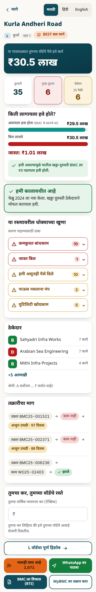
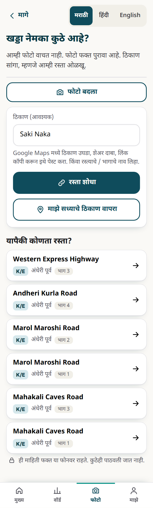
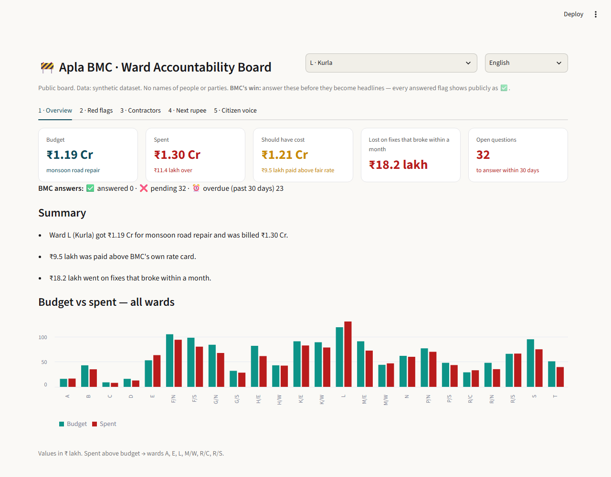
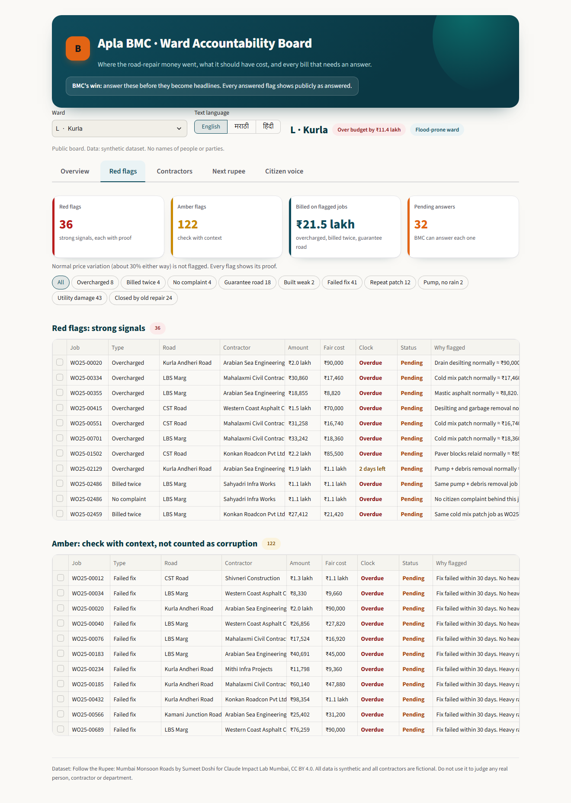
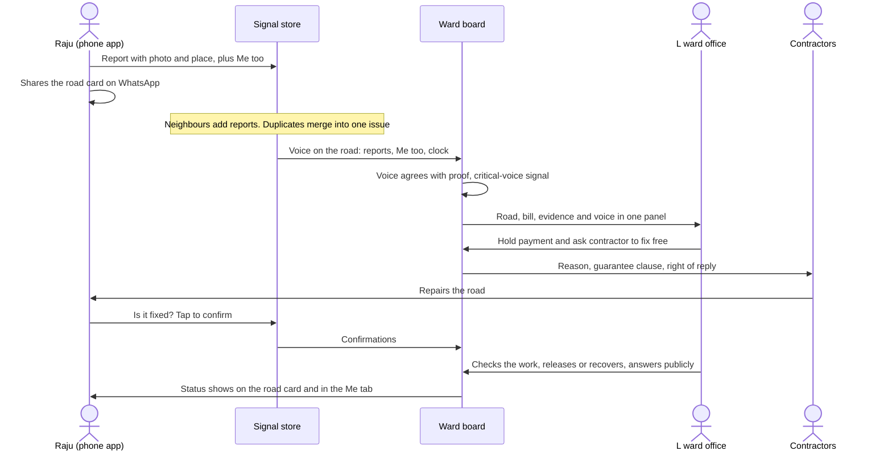

# Use case story: from a pothole photo to a held payment

### Kurla Andheri Road, Mumbai · *How one citizen's report reaches the ward office, and what the ward office can do about it*

This is the story we tell to explain **why the phone app and the dashboard are two halves of one system.** It is a *target scenario*. The road, the contractor, the jobs and the amounts are real records from the (synthetic) dataset; the new complaints and the payment decision are the story. Section 8 says exactly what exists today and what a pilot would need to build.

> **Story rules.** Figures marked *(story)* are illustrative. The dataset records repair bills, not payment status, so "a bill awaiting payment" is a stated assumption. No officer is named: the ward office acts as an office, and only citizens and contractors are named, all fictional.

---

## 1. The cast

| Who | Role in the story |
|---|---|
| **Raju**, 45 | Lives in Kurla. Reads Marathi best, lives on WhatsApp. Walks Kurla Andheri Road to the station every day |
| **The Kurla residents' WhatsApp group** | Neighbours who share the same road |
| **L ward office** | BMC's ward office for Kurla. It reads the board and decides what to do with a bill |
| **Arabian Sea Engineering** | A (fictional) maintenance contractor that BMC has paid for repairs on the road |
| **The original resurfacing contractor** | Resurfaced the road in Feb 2024 and, under the guarantee, still owes free pothole and cave-in repairs. *(Not named in the dataset.)* |

---

## 2. What the record already says (real, from the dataset)

Before Raju does anything, the data already shows a road in trouble:

| Fact | Value |
|---|---|
| Money spent on the road this monsoon | **₹30.5 lakh** across **35 repairs** |
| Fixes that broke again | **6** |
| Jobs finished on time | **6 of 35** |
| Should have cost (BMC's rate card) | ₹29.5 lakh |
| Guarantee | **Resurfaced 17 Feb 2024, so still under guarantee.** Pothole repairs should have cost BMC ₹0 |
| Repairs BMC paid for anyway | **10 jobs, ₹8.4 lakh**, the "built weak" and "guarantee road paid" flags |
| Arabian Sea Engineering on this road | **7 jobs, ₹7.7 lakh**, 2 broke within a month, **0 of 7 on time** |
| Arabian Sea Engineering in L ward | **Grade F**: 27 of 32 fixes lasted, 8 of 32 on time, price above normal, 7 red flags |
| One flagged job | **WO25-00020**, drain desilting billed **₹1,95,064** against a rate-card **₹90,000** (2.2×) |
| The latest guarantee-road repair | **WO25-02068**, a cave-in repair by Arabian Sea Engineering, **₹1,97,710**, finished 2 Sep 2025, **reopened within 30 days** |

> **Story assumption:** the ₹1,97,710 bill for WO25-02068 has not yet been fully paid and is waiting on approval. *(The dataset does not record payment status.)*

The problem is that nobody who walks the road can see any of this, and nobody at the ward office is looking at the road *and* the citizens' reaction at the same time.

---

## 3. The story, step by step

### Day 0, morning: Raju sees the crater

A cave-in has opened again at the same spot near the station. Raju opens **आपला BMC** and taps **माझ्या जवळचा रस्ता तपासा**.



He sees, in Marathi and in plain words: ₹30.5 लाख spent, 35 repairs, **broke again 6 times**, and a green box: **"Under guarantee. Resurfaced Feb 2024. The contractor should repair potholes free."** He did not know the road was still guaranteed. Neither did most of his neighbours.

### Day 0, 10:40: he raises it

He taps the camera button and takes a photo of the crater. The app does not pretend to read the picture. It asks **where it is**, because a photo alone proves nothing, so he pastes a Google Maps link from the pin he dropped.



The app finds the nearest road, confirms *"Place found from the Google Maps link"*, and saves the report with its **photo, its place and the time**. He then taps **Me too**, and **WhatsApp** to share the road's account with the residents' group. For the official record he taps **MyBMC** to lodge the complaint with BMC itself. *(We link to BMC's complaint channel rather than replace it.)*

### Day 0, afternoon: the neighbours join

Neighbours open the shared link, see the same road card, and add their own photos and **Me too**. By evening *(story)* **18 people** have backed the road, and several have photographed the same crater from different angles. The system sees these as **one issue, not 18**: duplicates at the same place are merged, so volume cannot be faked by one person tapping repeatedly (one tap per road per device).

### Day 1: the voice builds

By the next evening *(story)* **41 reports and 120 "Me too"** sit on Kurla Andheri Road within a few hundred metres. The reports are in Marathi, Hindi and English. Three mention that a two-wheeler skidded on the crater.

### Day 1, evening: the ward board notices

On the **Ward Accountability Board**, L ward's **Overview** shows *Open questions* climbing, and the **Citizen voice** tab shows Kurla Andheri Road at the top of the "Me too" list.



More importantly, the road trips a **critical-voice signal**. That is not "many people are cross." It is the **combination** the system looks for (the thresholds are a proposal, see section 6):

1. **A cluster of independent reports** at one place in a short window,
2. on a road that **already carries unanswered red flags** (here: guarantee-road repairs paid by BMC, a failed fix, an overcharged bill),
3. against a contractor with a **poor, fairly-measured record** in the same ward (Grade F).

Volume alone never triggers it. The proof has to agree with the voice.

### Day 2, morning: the ward office looks at the evidence

The ward office opens **Red flags**, finds **WO25-02068**, and clicks the row.



The evidence panel shows, in one place:

- **The proof:** guarantee road resurfaced 17 Feb 2024 · the repair reopened within 30 days · the job's amount · the rate-card line · the contractor's record (7 jobs on this road, 0 of 7 on time, Grade F in the ward).
- **The voice:** 41 reports, 120 "Me too", the photos with their places, three mentions of a skid, and the open **30-day clock**.

There are three things the office can do here, and each one is a button already on the board.

| Button | Effect in the story |
|---|---|
| **Answer** | Publishes a public reply on the flag (shows as answered) |
| **Hold payment** | Marks Arabian Sea Engineering's bill for WO25-02068 *payment held pending review*, with the reason recorded |
| **Ask contractor to fix free** | Invokes the guarantee: asks the **original resurfacing contractor** to repair the road at no cost to BMC |

### Day 2, 11:00: payment held, guarantee invoked

The office makes two moves, for two different reasons:

1. It **holds the ₹1,97,710 payment to Arabian Sea Engineering.** The repair failed within 30 days, and it was on a road where the guarantee means BMC should not have been paying for it at all.
2. It **asks the original resurfacing contractor to fix the cave-in free under the guarantee**, so the road is repaired at no cost to BMC.

It writes a short public answer: *"Payment for the last repair is held. The road is under guarantee; the original contractor has been asked to repair it free. We will confirm once it is fixed and checked."*

The hold is a **decision by the ward office, recommended by evidence**. It is not triggered by the number of complaints. Both contractors are told why and given a right of reply.

### Day 2, evening: Raju sees the answer

Raju's **Me** tab, under *latest on your roads*, now reads *"BMC has answered. Payment held. Original contractor asked to fix free."* The road card shows the same status, and the neighbours who shared the link see it too. For the first time they can see that **someone is acting on it, and why.**

### Day 6: the fix, and the check

The original contractor fixes the cave-in under the guarantee. The ward office asks for an after-photo. The app asks the people who reported it a single question: **"Is it fixed?"** Residents answer with a tap. Where several independent residents confirm it and the ward office has checked the work, the case can close. If the road is still bad, the status stays open and the clock keeps running.

### Day 8: the outcome

| Outcome | Result |
|---|---|
| The road | Repaired **under the guarantee**, at no cost to BMC |
| Arabian Sea's held bill | The ₹1,97,710 is released, reduced, or recovered according to what the office finds, with the reason on record |
| The flag | Shows publicly as **answered**; the 30-day clock is closed |
| The contractors | The original contractor honoured the guarantee. Arabian Sea's record still shows a failed fix, and the ward grade reflects whether fixes last |
| Raju | Knows what happened, and why, and can see the next flagged road |

**One photo, one place, and a crowd of independent neighbours turned a failing repair into a held payment, a free fix and a public answer.**

---

## 4. Sequence at a glance



---

## 5. Why a payment is held, and why it is fair

Holding a contractor's money is serious. The design keeps it defensible.

- **Voice plus proof, never voice alone.** The signal needs the citizen reports to agree with the flags the data already shows. A crowd cannot hold a payment for a road with nothing wrong.
- **Independent voices count, repeated taps do not.** One tap per road per device, duplicates merged, reports must carry a place near a road we hold (within 3 km), and a place outside Mumbai is refused.
- **A human decides.** The system recommends. The ward office presses the button, and the reason is recorded.
- **Right of reply.** Both contractors see the reason and can respond or repair.
- **Reversible and on the record.** A hold can be released; every step is logged and visible publicly as answered.
- **Fair measure.** Waterlogging, drain and manhole jobs are never counted against a road contractor, and contractors are compared only within their own ward.
- **No names of officers or parties.** Accountability sits at the level of the **contractor** and the **ward office**.
- **A guarantee changes the question.** On a guarantee road the first move is not "pay less," it is **"make the original contractor fix it free,"** so BMC's cost is ₹0.

---

## 6. How "critical voice" could be decided

A proposal to tune with a pilot ward, not a finished rule. All numbers here are placeholders.

```
critical_voice(road) = 
      independent reports in the last 7 days        >= N1        (for example 25)
  AND reports fall within ~200 m of the road
  AND the road has an unanswered red flag          (guarantee paid, failed fix, overcharged, built weak)
  AND a failed fix or a missed deadline in the last 30 days
  AND contractor's fair ward grade                 is C or worse
```

- **Independent** means distinct devices after duplicate merging, not the raw number of taps.
- **Severity** can raise the priority (a report that mentions an accident, a school or an ambulance route).
- The output is a **flag on the board for the ward office**, never an automatic stop.

---

## 7. The same story from each person's side

| | Before | After |
|---|---|---|
| **Raju** | Saw a crater, had no way to learn the road was guaranteed, filed a complaint and heard nothing | Knows the guarantee, raised a report with proof, can see the answer on the road |
| **Neighbours** | Complained one by one | One shared signal with proof, hard to ignore |
| **L ward office** | Saw complaints and bills in different places | Sees the bill, the proof and the people's voice on one screen, with a 30-day clock |
| **BMC** | Paid again for work under guarantee | Recovers the free repair; shows public answers |
| **Contractor** | Paid regardless of whether the fix lasted | Paid for work that lasts, with a fair right of reply |

---

## 8. What exists today, and what a pilot needs

Honest status, so the story is never mistaken for a finished product.

| Step in the story | Today | A pilot would need |
|---|---|---|
| See a road's money, guarantee and flags in plain Marathi | ✅ Built and live | |
| Add a photo that **needs a place** (Maps link, GPS, address, photo location) | ✅ Built; stored **on the phone** | Send the report to a shared store |
| **Me too** (one tap per road per device) | ✅ Built; counts **on the phone** | A shared counter |
| Share on WhatsApp, ready RTI letter | ✅ Built | |
| Link to BMC's own complaint channel | ✅ Built | Pre-filled complaint text where BMC allows |
| Reports and Me too **appear on the board live** | ❌ Not built. The board reads a **static data file** | A small shared backend (a database and two endpoints) |
| Duplicate merging and the "citizen voice" view | ✅ Built for the **dataset's complaints** | Run it on live reports |
| **Critical-voice signal** | ❌ Not built | The rule in section 6, tuned in a pilot ward |
| Board actions: **Answer, Hold payment, Ask contractor to fix free** | ✅ Buttons built; status is kept **only in the open browser session** | Save to the shared store with the reason and an audit log |
| Status shown back on the citizen's road card and Me tab | ❌ Not built | Read status from the shared store |
| "Is it fixed?" confirmation by residents | ❌ Not built | One tap, stored with the place |
| Real payment hold in BMC's accounts | ❌ Not possible from here | **BMC's own process.** The board gives the evidence; the ward office holds the payment in its own system |

> **Important:** the board does not stop real money. It records and recommends. Actually stopping a payment is BMC's decision in BMC's own system, with the reason and the evidence this board provides.

### The smallest build that makes the story real

```
 Phone app ──POST /reports, /metoo──▶  Shared store (one table: reports, one: metoo, one: actions)
                                              │
 Board ◀──GET live reports per ward───────────┤
 Board ──POST /actions (answer, hold, fix-free) ─▶ same store ──▶ shown on the phone road card
```

Three tables (reports, "Me too", ward actions), a handful of endpoints, and the existing screens. The board's critical-voice panel and the phone's status line are small additions on top of what is already built.

---

## 9. A 90-second version we can demo today

Everything here runs on what is built now:

1. **Phone:** open the live app, tap **माझ्या जवळचा रस्ता तपासा**, show **Kurla Andheri Road**: ₹30.5 लाख, broke again 6 times, **under guarantee**.
2. **Phone:** take a photo, show it **asks where**, paste a Google Maps link, show the report on the **Me** tab. Tap **Me too** and **WhatsApp**.
3. **Board:** open **L ward → Red flags**, click **WO25-02068**. Show the proof (guarantee road, reopened within 30 days, contractor Grade F).
4. **Board:** press **Hold payment**, then **Ask contractor to fix free**, then **Answer**. The status changes on screen.
5. **Say plainly:** *"In a pilot, the phone's report and the board's action travel through a small shared store, so the citizen sees the answer on their own road. Today the two halves share one data file."*

---

## 10. How we would know it works

These are the measures a pilot would track. They are measures, not results we claim.

- **Time to first answer** on a flagged job, against the 30-day clock.
- **Share of flags answered** within 30 days.
- **Repeat failures** on a road after a flag (fixes that break again within a month).
- **Guarantee repairs recovered**: repairs done free by the original contractor.
- **Rupees held, reduced or recovered** with a recorded reason.
- **Citizen confirmation rate** on "Is it fixed?".

---

## 11. Questions we expect

**Can a crowd hold a contractor's payment unfairly?**
No. The signal needs voice **and** proof, counts independent people rather than taps, and ends in a human decision with a right of reply.

**Does the app stop real payments?**
No. It gives the ward office the evidence and records the decision. Stopping a payment happens in BMC's own system.

**What if people brigade a road?**
One tap per road per device, duplicates merged, a place that must be near a road we hold, and no trigger without proof from the data. A pilot would add phone verification if needed.

**Why not just let people complain on MyBMC?**
They still should, and we link to it. A complaint says something is broken. This shows **who was paid, whether the road is guaranteed, and whether the fix lasted**, and puts the people's voice next to the proof.

**Is any of the data real?**
No. All data is synthetic and all contractors are fictional. The story shows the method.
